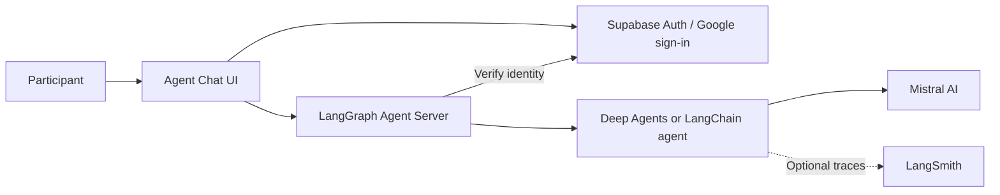

# Agent Harness Workbench

A workbench for building and studying conversational AI agents with a customizable
agent harness and user experience. The project combines a Python backend with a
web chat interface so researchers can control how an agent interacts with study
participants and investigate those interactions in detail.

## Motivation

Research on human–AI interaction can require changes to an agent's instructions,
context management, memory, and interface, alongside detailed records of what
happened during a conversation. Hosted chat products such as ChatGPT and Claude
can be useful research tools, but their web interfaces limit the changes a
researcher can make and the execution data they can collect.

This project puts the harness and interface under the researcher's control. The
aim is to support experiments that can vary agent behavior and interaction design
while retaining enough data to reconstruct and analyse participant–agent exchanges.

## Architecture

The application has two main layers:

- **Backend:** Python agents running through LangGraph Agent Server. It handles
  model execution, conversation state, authentication, and per-user access control.
- **Frontend:** a customized Agent Chat UI for sign-in, streaming conversations,
  and private chat history. The interface can be adapted to a study's needs.

| Component | Technology and role |
| --- | --- |
| Agent framework and harness | Deep Agents, built on LangChain and LangGraph; a simpler LangChain agent is also available for comparison |
| Backend API and persistence runtime | LangGraph Agent Server, serving both agent implementations |
| User experience | Agent Chat UI, built with Next.js and React |
| Authentication | Supabase Auth with Google sign-in; the backend verifies user identity and enforces conversation ownership |
| Model completions | Mistral AI through its LangChain integration |
| Optional tracing | LangSmith for inspecting agent execution and model calls |
| Remote development access | ngrok exposes the local frontend; frontend API forwarding reaches the local backend |

ngrok provides connectivity for remote testing; authentication and conversation
isolation are enforced by the application independently of the tunnel.

## Research recording

A planned use case is recording chat history and execution detail for research
and analysis across participants and sessions. The proposed SQLite archive will
preserve user and conversation IDs, turn and message ordering, timestamps,
original content and formatting, tool interactions, model inputs and outputs,
and relevant execution metadata. It will support reconstruction and export for
analysis.

The application currently supports authenticated chat, private conversation
history, and optional LangSmith tracing. The dedicated research archive is
**planned, not implemented**. Its design is documented in the
[SQLite recording plan](plans/chat-recording-sqlite.md).

## Setup

1. Configure Mistral and Google sign-in through Supabase using the
   [shared service setup guide](docs/setup.md).
2. Install, configure, and start the backend using the
   [backend setup guide](backend/README.md).
3. Install, configure, and start the chat interface using the
   [frontend setup guide](frontend/README.md).
4. If needed, enable [remote testing through ngrok](docs/setup.md#optional-ngrok-access)
   and [LangSmith tracing](docs/setup.md#optional-langsmith-tracing).
5. [Verify chat, sign-in, and conversation isolation](docs/setup.md#verify-the-whole-setup).

## Project layout and further documentation

| Location | Contents |
| --- | --- |
| [backend/](backend/README.md) | Agent implementations, authentication, tests, and backend setup |
| [frontend/](frontend/README.md) | Chat interface and frontend setup |
| [docs/](docs/) | [Shared service setup](docs/setup.md), [Google sign-in details](docs/google-auth.md), and supporting reference material |
| [plans/](plans/) | Proposed features and implementation plans |

Additional references cover [frontend customization](docs/frontend-customization.md)
and [frontend upstream provenance](docs/frontend-upstream.md).

## License

Licensed under the [MIT License](LICENSE), matching the upstream Agent Chat UI.
The frontend includes code by Brace Sproul; its original copyright and license
are preserved in [frontend/LICENSE](frontend/LICENSE). See
[upstream provenance](docs/frontend-upstream.md) for the imported revision.
